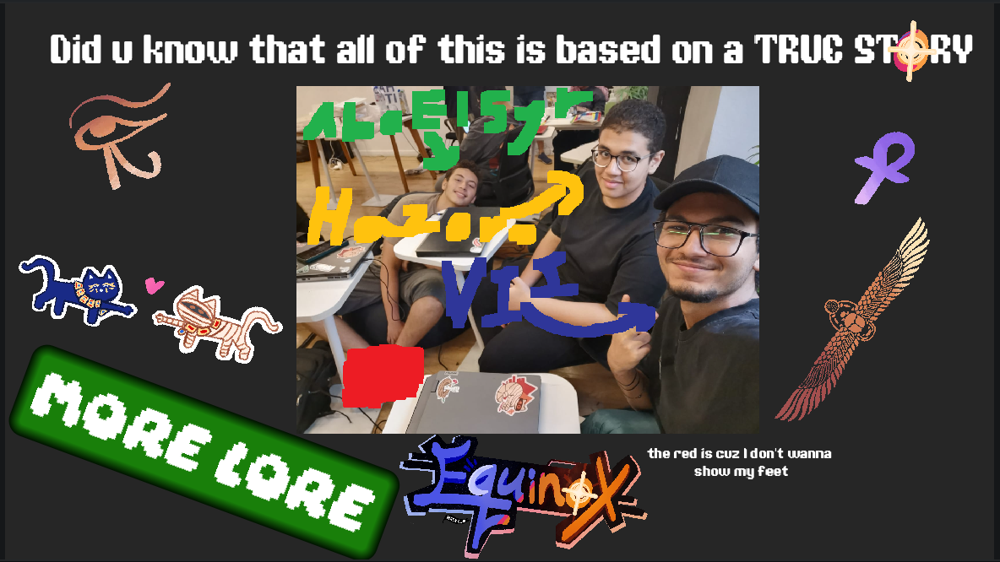
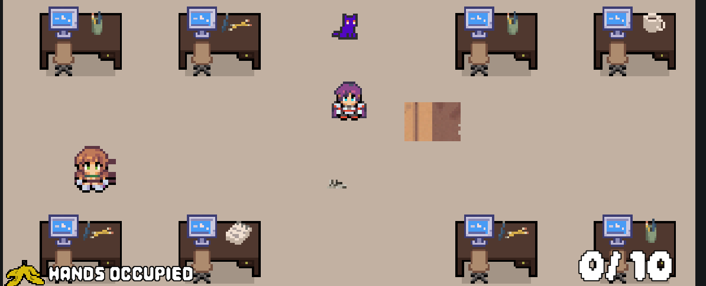
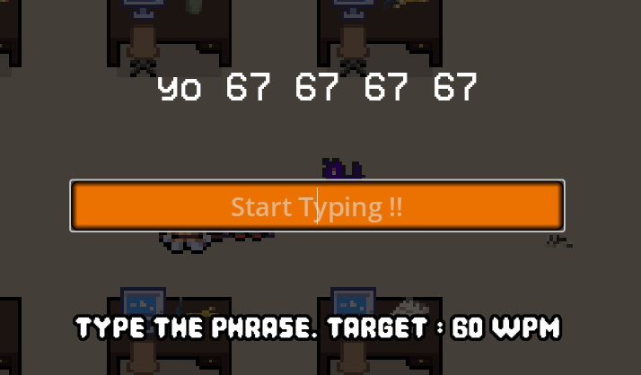
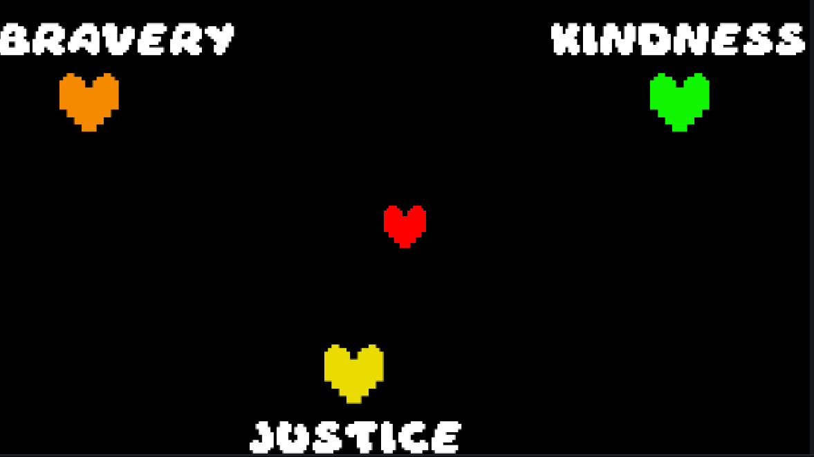
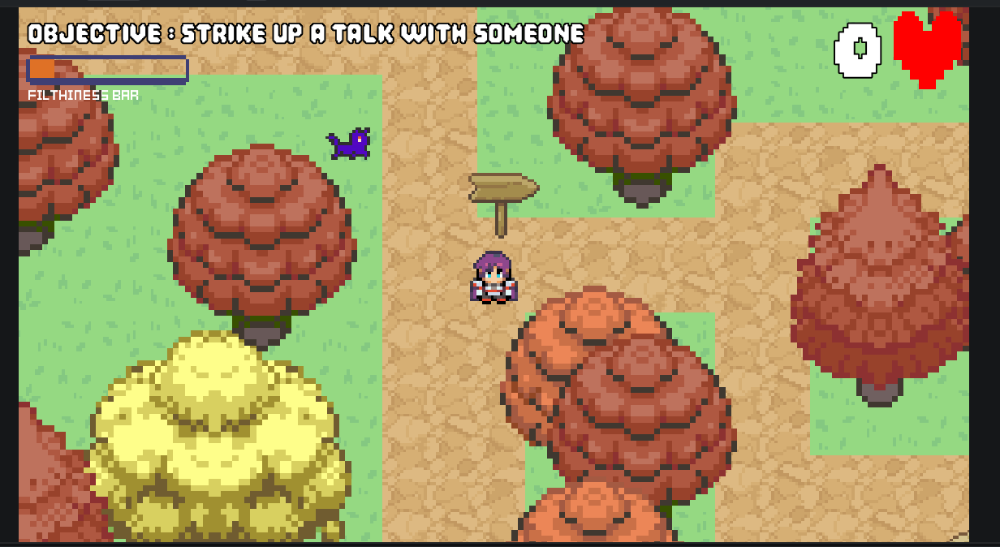
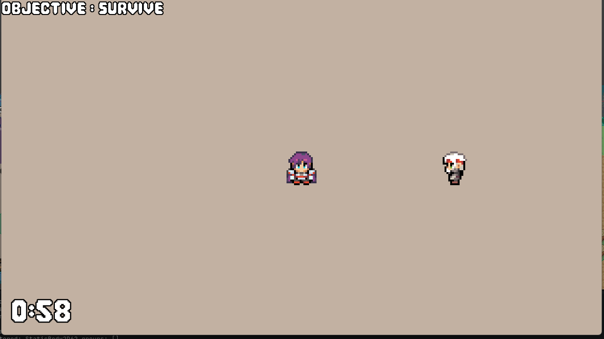

# A Hackclub Adventure
## Your first hackathon experience
## Based on a true story from [Hazoro](https://github.com/hazorox), [Vii](https://github.com/vii-abdullatif), and [AboEl5yr](https://github.com/AdhamMohamedKhairy)
### Live at [Itch.io](https://hazoro.itch.io/a-hackclub-adventure) Go Check Now !!

# Backstory
The 3 of us, agreed to try our first IRL Hackclub Hackathon in Equinox, Egypt. We didn't expect it to be such a unique experience different from all the other hackathons we visited...
 (Lore accurate pic from Equinox!!!!)
It was so coollllll, that since then, we have been trying to manage to go to another hackathon while managing school and third space (We're suffering :sob:)

Our real names for refrence : Hazoro>>Hamza, AboEl5yr >> Adham, Vii >> Abdullatif

# Lore
You're a new Hackclubber in your first hackathon alone, try to talk with someone or anything, and trust, y'all will have fun together easily.

# Introduced Minigames
## Gather Rubbish
Ellie, a friendly co-operating person, asks you to help her gather the messy stuff and rubbish together

You have to gather the rubbish thrown around one at once and go to the nearest rubbish bin

## TypeRace
Stacy, a keyboard nerd, challenges you for a typing test. She writes at an average of 60WPM, yet she still believes she is good.

You're given 5 phrases and you have to re-write the phrases with your own speed and beet Stacy's 60 words per minute

Note : you can't continue with inaccuracies like MonkeyType, you have to finish the entire phrase accurately.


## Flowery
You meet someone obsessed with fandoms and games, Deltarune specifically. They introduce you to the 7 flowers and their personalities.

You are spawned as the red soul in a hall containing all the other souls and you learn about their personalities.

## Flithniess & Hygiene
Important !! Don't forget to stay hygenic as much as possible

you gather napkins, deodrants, and water and more hygiene related stuff in order to keep clean
## Autumn Garden
Light up the fire to unlock Wemmbu as a friend

Credits for the beautiful tilemap art to AboEL5yr

## Debugger
Become a professional and spot the logical mistakes and bugs in code

You're given a code snippet and 3 code statements to place in the gaps, choose the correct one
## Rhythm
Hit the arrows with the same times as notes in order to "rhyme"

Use WASD and hit the arrows in the same time as the notes pass by
## Where is my charger ?
A mate you met there ( you forget names quickly uhm ) has lost their charger. Luckily, they just made a metal detector for a cool YSWS. You use this metal detector to find where the charger is..

It beeps louder the closer you are to it :D
## And many many more (and maybe some secret?) !!

# Controls
- Main movement : WASD
- Secondary movement : heart, garbage can, etc. Arrows
- Interaction : E or Space depending on type of interaction
- Pause : Escape
- Fullscreen : can be accessed through main menu or pause screen
- Buttons in UI navigation : can be accessed through mouse clicks or cycling focus using Tab

# Local setup
```sh
git clone https://github.com/Hazorox/a-hackclub-adventure-new.git
cd a-hackclub-adventure-new/
```
Then use godot 4.7 to open

# Note
some parts may be rushed or not working fully properly, please report them to me, Hazoro, on slack rightaway !!

Me (Hazoro) & AboEl5yr are absolute newbies to gamedev. We're planning to improve our games quality moving on.

# AI-Claude Usage (Hazoro) :
- Help with the typetest input detection tracing
- Debugging damage caused to files caused from merge conflicts
- help with loading some certain files and textures

Made with Love by our Local HC Trio :D


# Hidden Game Mode ? (Runner)

RUNNNNNNN from the scawy NPC (NOT A FRIEND)
- Made by AboEl5yr